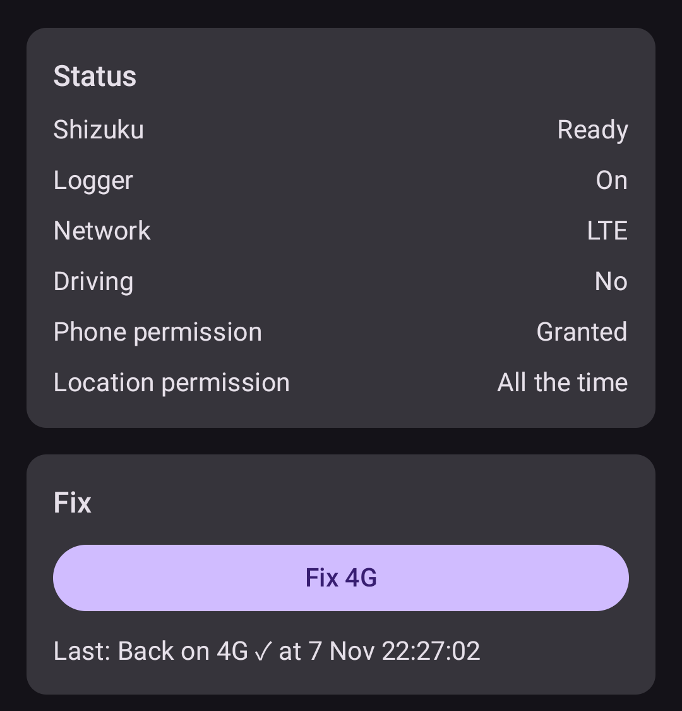

# Unstick4G

A small Android app that gets my phone back from "stuck on 2G" to 4G with one tap, and logs when and where it happens.

It is a personal tool for one phone: a Samsung Galaxy A60 on Android 11, on a UK network.

## Why it exists

- The UK has switched off 3G, so when 4G drops, the phone falls straight to 2G.
- The A60 (a China/Hong Kong model) has no LTE Band 20 (800 MHz), the UK's main rural 4G band. On country roads it really does lose 4G, and software can't change that.
- What software can fix: when coverage comes back, the phone **stays on 2G** until I step in. Setting Network mode to "2G only" and back, or turning flight mode on and off, brings 4G back.

Unstick4G does that step for me. It also records data, so a later version can do it automatically, with thresholds taken from real drives.

## What it does

- **Fix:** a Quick Settings tile and an in-app button. The Fix sets the preferred network mode to 2G only for a few seconds, then restores the exact mode it found. If the phone doesn't allow that, it turns flight mode on and off instead. Then it watches the network for up to 30 seconds and tells you "Back on 4G ✓" or "Still on 2G — probably no usable 4G here."
- **Auto-fix when you park:** after the phone disconnects from the car's Bluetooth, it checks every 10 seconds for up to a minute, and runs the Fix by itself at the first check that finds it on 2G. If it is still on 2G about 5, 15 and 45 minutes after parking, it tries again. Those later checks can run late if the phone is asleep, because the app only keeps it awake for the first minute, and any check that comes more than an hour after parking is skipped. Reconnecting cancels it, so a short Bluetooth drop mid-drive does nothing. In my logs, the long stuck spells started at the end of a drive. You only get a notification if it didn't work. A switch in Settings turns it off.
- **Safety:** the original mode is saved before the switch, and restored on the next start if the app dies halfway. The Fix does nothing during a call, or when the network mode isn't the normal auto mode.
- **Logger:** a foreground service, started at boot, records every network-type change. It never changes anything.
- **Location only while driving:** while the phone is connected to the car's Bluetooth (you pick the car once in Settings) *and* location is on, it records a GPS sample every 30 seconds and on every network change, with the LTE cells the phone can see.
- **Export:** one CSV per table, zipped, sent through the share sheet. Data older than 90 days is deleted automatically.

## How the Fix works

The network mode can only be changed by system apps or the shell user. Unstick4G calls the hidden `ITelephony.getPreferredNetworkType` and `setPreferredNetworkType` through Shizuku's binder wrapper, so each call runs as the shell user. [HiddenApiBypass](https://github.com/LSPosed/AndroidHiddenApiBypass) lets the app reach those hidden classes. The flight-mode fallback uses `IConnectivityManager.setAirplaneMode`, the same call that `cmd connectivity airplane-mode` makes.

Both methods sit behind one `NetworkKicker` interface, and the Fix method setting picks between them at runtime.

## Install

Download `unstick4g-debug-apk` from the latest successful [CI run](https://github.com/WyattHui/Unstick4G/actions/workflows/ci.yml) and sideload it.

Local and CI builds are signed with the same debug key (`app/debug.keystore`, committed on purpose). So each new build installs over the last one and keeps the logs.

## Shizuku setup

Unstick4G gets shell-level access through [Shizuku](https://github.com/RikkaApps/Shizuku), without root.

1. Install Shizuku.
2. Turn on Developer options: Settings > About phone > Software information, then tap Build number seven times.
3. In Developer options, turn on Wireless debugging. Wi-Fi must be on.
4. Open Shizuku, choose Start via Wireless debugging, and pair it with the pairing code. You only pair once.
5. Tap Start.
6. Open Unstick4G and tap Allow next to Shizuku.

Shizuku stops when the phone restarts, and it can occasionally stop on its own. After a restart, Unstick4G posts "Shizuku is off — tap to start it" and the tile shows "Needs Shizuku". If Shizuku stops while the phone is on, Unstick4G posts the same alert and records the time in `shizuku_stops.csv`. Repeat step 5.

## Permissions

| Permission | Why |
|---|---|
| Phone (`READ_PHONE_STATE`) | Read the network type and the call state. |
| Location, "Allow all the time" (`ACCESS_FINE_LOCATION`, `ACCESS_BACKGROUND_LOCATION`) | GPS samples and LTE cell details while driving. The logger starts at boot with no screen open, so Android 11 counts this as background use. |
| Bluetooth (`BLUETOOTH`) | List paired devices, and see when the car connects or disconnects. |
| Run at startup (`RECEIVE_BOOT_COMPLETED`) | Start the logger after a restart. |
| Keep awake (`WAKE_LOCK`) | Keep the phone awake for the few seconds a Fix takes, so an automatic Fix with the screen off still switches back on time. |
| Foreground service | Keep the logger running, with a low-priority notification. |
| Shizuku | Change the network mode or flight mode as the shell user. |

On Android 11, "Allow all the time" can't be granted from a pop-up. The app asks for location first, then opens the settings page where you choose "Allow all the time".

## Privacy

- Location is recorded only while the phone is connected to the car's Bluetooth and location is on. Never at home or on foot.
- Everything stays in a local database on the phone. Nothing leaves it unless you export it. The app makes no network calls and has no analytics.
- It doesn't use Google Play Services, which China/Hong Kong firmware may not have.

## Exported data

| File | Columns |
|---|---|
| `network_events.csv` | timestamp, data_type, voice_type, signal_dbm, in_drive |
| `drives.csv` | drive_id, start, end |
| `location_samples.csv` | timestamp, lat, lon, accuracy_m, speed_mps, drive_id, data_type, voice_type, lte_cells |
| `fix_attempts.csv` | timestamp, method, type_before, type_after, seconds_on_2g_before, result, duration_ms, source |
| `shizuku_stops.csv` | timestamp |

Timestamps are UTC, in ISO 8601. `lte_cells` lists each LTE cell the phone can see as `ci:pci:earfcn:bands:rsrp`, separated by `;`. A value the phone didn't report is left empty. `source` is `MANUAL` for a Fix you tapped and `CAR_DISCONNECT` for an automatic one.

## Development

- Kotlin, Jetpack Compose and Room. minSdk 30, one module.
- Built and tested for Android 11 only. Newer Android versions would need extra permission handling (Bluetooth, notifications, the logger's location service, the tile).
- Needs JDK 17 and the Android SDK with platform 37.
- `./gradlew assembleDebug testDebugUnitTest` builds the APK and runs the unit tests. CI runs the same on every push and pull request.
- The logger uses `PhoneStateListener`, which is deprecated, because its replacement `TelephonyCallback` only arrived in Android 12.

The full spec and milestones are in [SPEC.md](SPEC.md).

## Licence

MIT. See [LICENSE](LICENSE).
